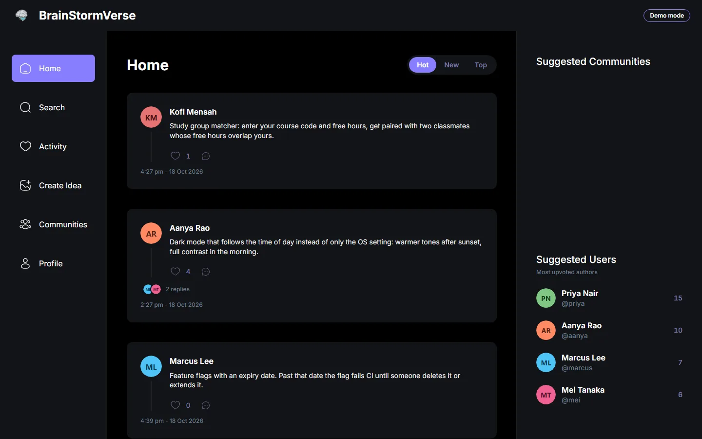
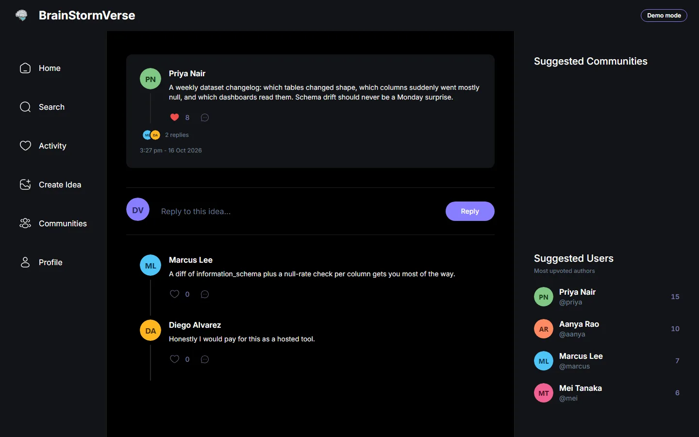
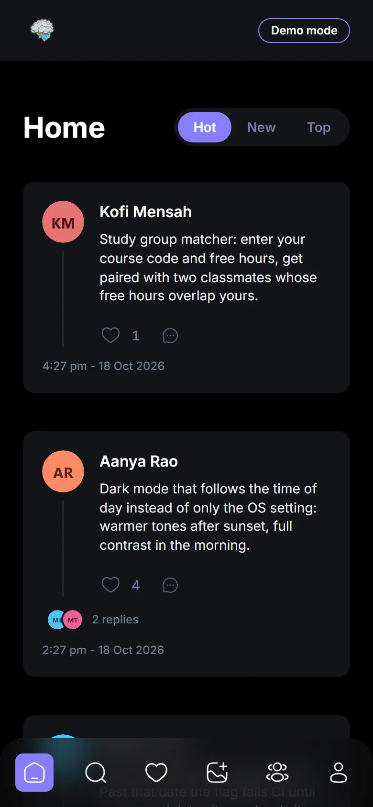
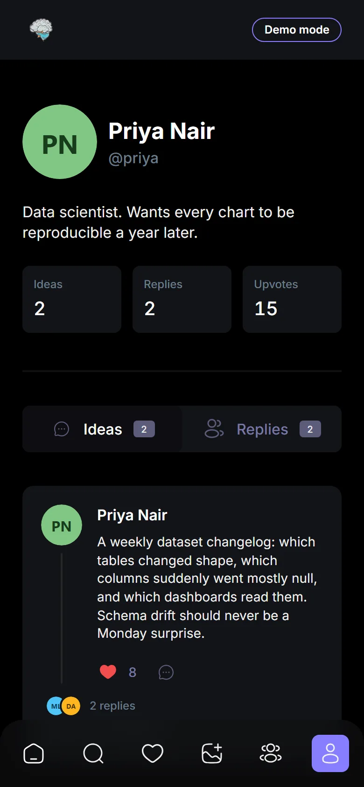
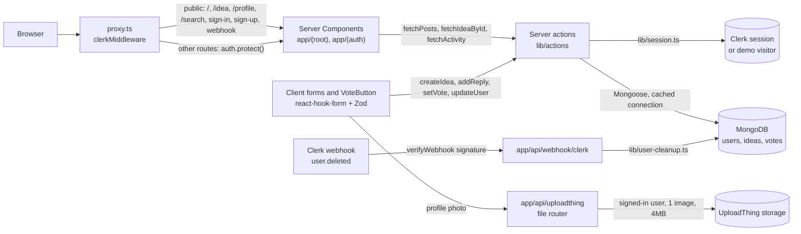

# 💡 BrainstormVerse

A modern idea-sharing platform where creativity meets collaboration. Share your thoughts, discover innovative ideas, and connect with like-minded creators in a beautifully designed interface.


[](https://github.com/Sagargupta16/brainstorm-verse/actions/workflows/ci.yml)
[](LICENSE)

Try it with no accounts or keys:

```bash
npm ci
npm run demo   # in-memory MongoDB, seeded data, http://localhost:3000
```

| Feed (desktop)                                             | Thread (desktop)                                                |
| ---------------------------------------------------------- | --------------------------------------------------------------- |
|  |  |

| Feed (phone)                                                                       | Profile (phone)                                                                           |
| ---------------------------------------------------------------------------------- | ----------------------------------------------------------------------------------------- |
|  |  |

Screenshots come from `npm run demo` and are regenerated with `npm run screenshots`.

## ✨ Features

- 🔐 **Secure Authentication** - Powered by Clerk for seamless user management
- 💭 **Idea Sharing** - Create and share your innovative ideas with the community
- 👤 **Profile Onboarding** - Set up your profile with a guided onboarding experience
- 📱 **Responsive Design** - Beautiful UI that works on all devices
- 🎨 **Modern Interface** - Clean design with TailwindCSS and shadcn/ui components
- 📁 **Photo Uploads** - Upload your profile photo using UploadThing
- **Upvotes with Hot, New and Top feeds** - one vote per person, enforced by a unique index; Hot uses a Hacker News style time decay computed inside MongoDB
- **Threaded replies** - every idea has a page (`/idea/[id]`) with its replies, and replies can be replied to
- **Profiles** - `/profile/[id]` shows a person's ideas and replies with idea, reply and upvote counts; `/profile/edit` edits your own
- **Activity and search** - `/activity` lists replies to and upvotes on your ideas; `/search` finds people and ideas
- **Demo mode** - `npm run demo` runs the full app without Clerk, MongoDB Atlas or UploadThing
- **Clerk webhook** - deleting a user in Clerk removes their profile, ideas, threads and votes from MongoDB, behind signature verification

## 🚀 Tech Stack

- **Framework**: [Next.js 16](https://nextjs.org/) with App Router
- **Language**: [TypeScript](https://www.typescriptlang.org/)
- **Styling**: [TailwindCSS](https://tailwindcss.com/) + [shadcn/ui](https://ui.shadcn.com/)
- **Authentication**: [Clerk](https://clerk.com/)
- **Database**: [MongoDB](https://www.mongodb.com/) with [Mongoose](https://mongoosejs.com/)
- **File Uploads**: [UploadThing](https://uploadthing.com/)
- **Form Handling**: [React Hook Form](https://react-hook-form.com/) + [Zod](https://zod.dev/)
- **Icons**: SVG assets in `public/assets/`
- **CI**: GitHub Actions (lint + production build), CodeQL, Renovate

## Architecture

Everything runs inside one Next.js 16 App Router app. There is no separate REST API: pages are React Server Components that read through server actions, and forms call the same server actions to write.



### Data model

| Model  | Fields                                                                                          | Notes                                                                                                                 |
| ------ | ----------------------------------------------------------------------------------------------- | --------------------------------------------------------------------------------------------------------------------- |
| `User` | `id` (Clerk user id), `username` (unique), `name`, `image`, `bio`, `onboarded`, `ideas[]`       | Mirrors the Clerk user; written by `updateUser` during onboarding                                                     |
| `Idea` | `text`, `author` -> User, `community`, `parentID`, `children[]` -> Idea, `upvotes`, `createdAt` | Self-referencing, so replies are Ideas with a `parentID`; the feed shows top-level ideas only; `upvotes` is a counter |
| `Vote` | `idea` -> Idea, `user` -> User, `createdAt`                                                     | Unique index on `(idea, user)`, so one person can upvote an idea once                                                 |

### How posting an idea works

1. `/create-idea` (server component) loads the Clerk user, looks up the Mongo profile, and redirects to `/onboarding` until the profile is marked `onboarded`.
2. `PostIdea` validates the text with Zod (3 characters minimum) in the browser.
3. The `createIdea` server action re-checks the Clerk session, resolves the session user's Mongo `_id`, and rejects the write if it does not match the submitted author, so a client cannot post as someone else.
4. The idea is saved, its id is pushed onto `User.ideas`, and the path is revalidated.
5. The home feed (`fetchPosts`) pages through top-level ideas in the chosen order (Hot by default) and populates each author.

### How voting and ranking work

- **One vote per person.** A vote is its own `Vote` document, and a unique index on `(idea, user)` makes the database reject a second one. Two racing clicks cannot both count, because the second insert fails with a duplicate-key error.
- **Idempotent action.** `setVote({ ideaId, voted })` sets the state rather than toggling it: `voted: true` inserts (a duplicate is a no-op), `voted: false` deletes. `Idea.upvotes` moves with `$inc` only when a Vote document was actually inserted or deleted, so retries never drift the counter.
- **Optimistic UI.** `VoteButton` flips the heart and count with React's `useOptimistic`, then the revalidated server props replace it (or roll it back if the action throws).
- **Hot ranking.** `score = (upvotes + 1) / (ageHours + 2) ^ 1.8`, the Hacker News shape. The +1 lets a brand-new idea rank on freshness alone, and the 1.8 gravity makes old ideas sink unless votes keep up. `lib/ranking.ts` builds the same formula as an aggregation expression, so MongoDB scores, sorts and pages, and only the page of ids is hydrated.
- **Top** sorts by `upvotes` then `createdAt`; **New** by `createdAt`. Compound indexes on `Idea` cover the feed, Top and per-author profile queries.

### Demo mode

`NEXT_PUBLIC_DEMO_MODE=true` swaps Clerk out: `proxy.ts` lets every request through, `AuthProvider` skips `ClerkProvider`, and `lib/session.ts` answers every "who is this" with the seeded Demo Visitor. Server actions still go through the same session helper and ownership checks, so demo mode exercises the real write paths. `npm run demo` sets this flag, starts MongoDB in memory with `mongodb-memory-server-core`, seeds it (9 users, 12 ideas, 16 replies, 53 upvotes), and runs `next dev`. Anyone who opens a demo deployment acts as that one shared account, so use it for local runs and throwaway previews, not for real users.

### Tech decisions

- **Server actions instead of API routes**: one typed call path for reads and writes, with authorization enforced on the server in each action.
- **Clerk**: hosted sign-in and sign-up, session checks in `proxy.ts` and again inside every mutating action.
- **Cached Mongoose connection** (`lib/mongoose.ts`): reused across action calls instead of reconnecting per request.
- **UploadThing**: the browser uploads the profile photo straight to storage; the file router only accepts it for a signed-in Clerk user.
- **Tailwind CSS v4, CSS-first**: theme tokens and component utilities live in `app/globals.css` (`@theme`, `@utility`), so there is no `tailwind.config.js`.

### Project status

Working today: sign-up and sign-in, onboarding with photo upload (revisiting `/onboarding` or `/profile/edit` edits the saved profile), posting an idea, the Hot/New/Top feed with upvotes, idea threads with replies, profiles, activity, search, the "Suggested Users" sidebar (most upvoted authors), the Clerk `user.deleted` webhook, and demo mode.

Not built yet: `/communities` (the sidebar link is a 404) and the "Suggested Communities" sidebar block, the profile "Tagged" tab, and pagination past the first 30 feed ideas. The top bar's `OrganizationSwitcher` needs Organizations enabled in the Clerk dashboard.

## 🛠️ Getting Started

### Quick look: demo mode

```bash
git clone https://github.com/Sagargupta16/brainstorm-verse.git
cd brainstorm-verse
npm ci
npm run demo
```

Open [http://localhost:3000](http://localhost:3000). The first run downloads a MongoDB binary for `mongodb-memory-server-core`. Set `PORT` to use another port. Everything is in memory and is gone when the process stops. Photo uploads need an UploadThing token, so they do not work in demo mode.

### Prerequisites

- Node.js 24 (pinned in `.nvmrc`; Next.js 16 needs 20.9 or later)
- npm (`package-lock.json` is the committed lockfile)
- A MongoDB database (local or Atlas)
- A Clerk application and an UploadThing app

### Installation

1. **Clone the repository**

   ```bash
   git clone https://github.com/Sagargupta16/brainstorm-verse.git
   cd brainstorm-verse
   ```

2. **Install dependencies**

   ```bash
   npm ci
   ```

3. **Set up environment variables**

   Copy `.env.example` to `.env.local` and fill in the values:

   ```env
   # Clerk Authentication
   NEXT_PUBLIC_CLERK_PUBLISHABLE_KEY=your_clerk_publishable_key
   CLERK_SECRET_KEY=your_clerk_secret_key

   # Database
   MONGODB_URL=your_mongodb_connection_string

   # UploadThing
   UPLOADTHING_TOKEN=your_uploadthing_token

   # Clerk webhook (optional, for user.deleted cleanup)
   CLERK_WEBHOOK_SIGNING_SECRET=whsec_your_signing_secret
   ```

   Optional: `npm run seed` loads the demo dataset into that database. It replaces the seeded `seed_*` users and the Demo Visitor with the same cleanup the webhook runs, so their ideas go along with any replies under those ideas and the votes on them, including replies and votes from real users. Other ideas and users are left alone.

   For the webhook, add an endpoint at `https://<your-domain>/api/webhook/clerk` in the Clerk dashboard (Webhooks), subscribe it to `user.deleted`, and copy its signing secret into `CLERK_WEBHOOK_SIGNING_SECRET`. See [Clerk's webhook sync guide](https://clerk.com/docs/guides/development/webhooks/syncing).

4. **Run the development server**

   ```bash
   npm run dev
   ```

5. **Open your browser**

   Navigate to [http://localhost:3000](http://localhost:3000) to see the application.

### Deploy to Vercel

[](https://vercel.com/new/clone?repository-url=https%3A%2F%2Fgithub.com%2FSagargupta16%2Fbrainstorm-verse&env=NEXT_PUBLIC_CLERK_PUBLISHABLE_KEY,CLERK_SECRET_KEY,MONGODB_URL,UPLOADTHING_TOKEN&envDescription=Clerk%20keys%2C%20a%20MongoDB%20connection%20string%20and%20an%20UploadThing%20token&envLink=https%3A%2F%2Fgithub.com%2FSagargupta16%2Fbrainstorm-verse%2Fblob%2Fmain%2F.env.example)

The button clones the repo into your Vercel account and asks for the four variables in `.env.example`. A MongoDB Atlas free cluster works for `MONGODB_URL`; run `npm run seed` against it once for starter content. For a read-and-play preview without Clerk, set `NEXT_PUBLIC_DEMO_MODE=true` and `MONGODB_URL` only (see [Demo mode](#demo-mode) for the shared-account caveat).

## 📁 Project Structure

```text
brainstorm-verse/
├── app/
│   ├── (auth)/           # Authentication routes
│   │   ├── onboarding/
│   │   ├── sign-in/
│   │   └── sign-up/
│   ├── (root)/           # Main application routes
│   │   ├── activity/
│   │   ├── create-idea/
│   │   ├── idea/[id]/    # Idea thread with replies
│   │   ├── profile/      # /profile, /profile/[id], /profile/edit
│   │   ├── search/
│   │   └── page.tsx      # Hot / New / Top feed
│   └── api/              # uploadthing, webhook/clerk
├── components/
│   ├── cards/            # IdeaCard, IdeaList
│   ├── forms/            # Profile, idea and reply forms
│   ├── shared/           # Layout, VoteButton, ProfileHeader, AuthProvider
│   └── ui/               # shadcn/ui components
├── constants/            # Navigation and tab constants
├── docs/screenshots/     # README screenshots (npm run screenshots)
├── lib/
│   ├── actions/          # Server actions
│   ├── models/           # User, Idea, Vote
│   ├── validations/      # Zod schemas
│   ├── demo.ts           # Demo mode flag
│   ├── ranking.ts        # Hot score, in TypeScript and as a MongoDB expression
│   ├── session.ts        # Clerk session or demo visitor
│   ├── user-cleanup.ts   # Used by the Clerk webhook
│   └── utils.ts          # Utility functions
├── public/               # Static assets (demo avatars in public/demo/)
└── scripts/              # demo, seed, screenshots
```

## 🎯 Usage

1. **Sign Up/Sign In**: Create an account or log in using Clerk authentication
2. **Complete Onboarding**: Set up your profile with basic information and a photo
3. **Create Ideas**: Share your thoughts and innovations with the community
4. **Explore**: Browse ideas from other users on the home feed
5. **Vote and reply**: Upvote ideas, switch the feed between Hot, New and Top, and reply on an idea's page
6. **Follow up**: See replies and upvotes on your ideas in Activity, and find people or ideas in Search

## 🔧 Available Scripts

- `npm run dev` - Start development server
- `npm run demo` - Run the whole app with an in-memory, seeded MongoDB and no Clerk
- `npm run seed` - Load the demo dataset into the database in `MONGODB_URL`
- `npm run screenshots [url]` - Capture the README screenshots from a running app (needs `npx playwright install chromium`)
- `npm run build` - Build the application for production
- `npm run start` - Start the production server
- `npm run lint` - Run ESLint for code quality
- `npx tsc --noEmit` - Type-check without building
- `npm run format` - Format code with Prettier

## 🤝 Contributing

Contributions are welcome! Please feel free to submit a Pull Request. For major changes, please open an issue first to discuss what you would like to change.

1. Fork the repository
2. Create your feature branch (`git checkout -b feature/AmazingFeature`)
3. Commit your changes (`git commit -m 'Add some AmazingFeature'`)
4. Push to the branch (`git push origin feature/AmazingFeature`)
5. Open a Pull Request

## 📝 License

This project is licensed under the MIT License - see the [LICENSE](LICENSE) file for details.

## 🙏 Acknowledgments

- [Next.js](https://nextjs.org/) for the amazing React framework
- [Clerk](https://clerk.com/) for seamless authentication
- [shadcn/ui](https://ui.shadcn.com/) for beautiful UI components
- [TailwindCSS](https://tailwindcss.com/) for utility-first CSS
- All the amazing open-source libraries that make this project possible

## 📞 Support

If you have any questions or need help, please open an issue on GitHub or reach out to the maintainers.

## 📖 Development Documentation

This section contains detailed setup instructions for developers who want to build this project from scratch or understand the development process.

### 🚀 Creating a New Next.js App (From Scratch)

If you want to recreate this project from scratch:

```bash
npx create-next-app@latest ./
```

**Configuration Options:**

- TypeScript: Yes
- TailwindCSS: Yes
- App Router: Yes

### 📦 Core Dependencies Installation

```bash
npm install @clerk/nextjs @uploadthing/react mongoose uploadthing
```

**Key Dependencies Explained:**

- **@clerk/nextjs**: Developer-first identity and user management system providing complete authentication, authorization, and user profiles
- **uploadthing**: File upload service with simple API and React components for handling user file uploads
- **mongoose**: MongoDB object modeling tool designed for asynchronous environments with promise and callback support

### 🎨 UI Setup

Install additional UI dependencies:

```bash
npm install tailwindcss-animate
```

**Setup Steps:**

- Customize `app/globals.css` according to your design needs
- Tailwind CSS v4 is configured in CSS: theme tokens and utilities live in `app/globals.css` (there is no `tailwind.config.js`)
- Clean up default content in `app/page.tsx`

### 📁 Folder Structure Setup

**Route Groups Configuration:**

- **Auth Routes**: Authentication-related pages
  - Sign-in, Sign-up, Onboarding pages
  - Uses Next.js route groups `(auth)`

- **Root Routes**: Main application pages
  - Home, Create Idea, and other core features
  - Uses Next.js route groups `(root)`

**Clerk Route Structure:**
Create the following folder structure for Clerk authentication:

```text
app/
└── (auth)/
    ├── sign-in/
    │   └── [[...sign-in]]/
    │       └── page.tsx
    └── sign-up/
        └── [[...sign-up]]/
            └── page.tsx
```

### 🔐 Clerk Authentication Setup

1. **Create Clerk Account**: Sign up at [clerk.com](https://clerk.com)
2. **Create New Project**: Set up your application in Clerk dashboard
3. **Environment Variables**: Add to `.env.local`:

```bash
NEXT_PUBLIC_CLERK_PUBLISHABLE_KEY=pk_test_xxxxxxxxxxxxxxxxxxxxxxxxxxxxxxxxxxxxxxxxxxxxxxxxxxxxxxxx
CLERK_SECRET_KEY=sk_test_xxxxxxxxxxxxxxxxxxxxxxxxxxxxxxxxxxxxxxxxxxxxxxxxxxxxxxxx
```

1. **Follow Documentation**: Complete setup using [Clerk's Next.js documentation](https://clerk.com/docs/nextjs)

### 📁 UploadThing File Upload Setup

For detailed UploadThing setup, refer to this comprehensive tutorial:
[UploadThing Setup Tutorial](https://www.youtube.com/watch?v=O5cmLDVTgAs&list=WL&index=4&t=215s) (timestamp: 3:13:58 / 5:50:34)

**Key Setup Steps:**

1. Create UploadThing account
2. Put the app token in `UPLOADTHING_TOKEN`
3. Set up file upload endpoints
4. Integrate upload components in your forms

---

Made with ❤️ by [Sagar Gupta](https://github.com/Sagargupta16)
