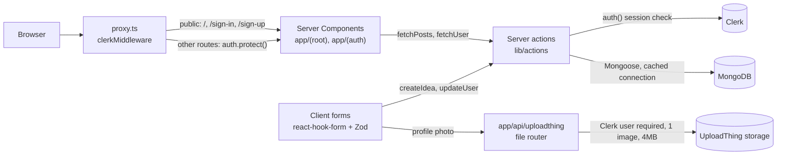

# 💡 BrainstormVerse

A modern idea-sharing platform where creativity meets collaboration. Share your thoughts, discover innovative ideas, and connect with like-minded creators in a beautifully designed interface.


[](https://github.com/Sagargupta16/brainstorm-verse/actions/workflows/ci.yml)
[](LICENSE)

## ✨ Features

- 🔐 **Secure Authentication** - Powered by Clerk for seamless user management
- 💭 **Idea Sharing** - Create and share your innovative ideas with the community
- 👤 **Profile Onboarding** - Set up your profile with a guided onboarding experience
- 📱 **Responsive Design** - Beautiful UI that works on all devices
- 🎨 **Modern Interface** - Clean design with TailwindCSS and shadcn/ui components
- 📁 **Photo Uploads** - Upload your profile photo using UploadThing

## 🚀 Tech Stack

- **Framework**: [Next.js 16](https://nextjs.org/) with App Router
- **Language**: [TypeScript](https://www.typescriptlang.org/)
- **Styling**: [TailwindCSS](https://tailwindcss.com/) + [shadcn/ui](https://ui.shadcn.com/)
- **Authentication**: [Clerk](https://clerk.com/)
- **Database**: [MongoDB](https://www.mongodb.com/) with [Mongoose](https://mongoosejs.com/)
- **File Uploads**: [UploadThing](https://uploadthing.com/)
- **Form Handling**: [React Hook Form](https://react-hook-form.com/) + [Zod](https://zod.dev/)
- **Icons**: SVG assets in `public/assets/`
- **CI**: GitHub Actions (lint + production build), CodeQL, Renovate

## Architecture

Everything runs inside one Next.js 16 App Router app. There is no separate REST API: pages are React Server Components that read through server actions, and forms call the same server actions to write.



### Data model

| Model  | Fields                                                                                    | Notes                                                                                         |
| ------ | ----------------------------------------------------------------------------------------- | --------------------------------------------------------------------------------------------- |
| `User` | `id` (Clerk user id), `username` (unique), `name`, `image`, `bio`, `onboarded`, `ideas[]` | Mirrors the Clerk user; written by `updateUser` during onboarding                             |
| `Idea` | `text`, `author` -> User, `community`, `parentID`, `children[]` -> Idea, `createdAt`      | Self-referencing, so replies are Ideas with a `parentID`; the feed shows top-level ideas only |

### How posting an idea works

1. `/create-idea` (server component) loads the Clerk user, looks up the Mongo profile, and redirects to `/onboarding` until the profile is marked `onboarded`.
2. `PostIdea` validates the text with Zod (3 characters minimum) in the browser.
3. The `createIdea` server action re-checks the Clerk session, resolves the session user's Mongo `_id`, and rejects the write if it does not match the submitted author, so a client cannot post as someone else.
4. The idea is saved, its id is pushed onto `User.ideas`, and the path is revalidated.
5. The home feed (`fetchPosts`) pages through top-level ideas newest first and populates each author.

### Tech decisions

- **Server actions instead of API routes**: one typed call path for reads and writes, with authorization enforced on the server in each action.
- **Clerk**: hosted sign-in and sign-up, session checks in `proxy.ts` and again inside every mutating action.
- **Cached Mongoose connection** (`lib/mongoose.ts`): reused across action calls instead of reconnecting per request.
- **UploadThing**: the browser uploads the profile photo straight to storage; the file router only accepts it for a signed-in Clerk user.
- **Tailwind CSS v4, CSS-first**: theme tokens and component utilities live in `app/globals.css` (`@theme`, `@utility`), so there is no `tailwind.config.js`.

### Project status

Working today: sign-up and sign-in, onboarding with photo upload (revisiting `/onboarding` edits the saved profile), posting an idea, and the home feed.

Not built yet: the sidebar links to `/search`, `/activity`, `/communities` and `/profile`, and the reply link on each card (`/idea/[id]`), have no pages behind them yet. The right sidebar's "Suggested Communities" and "Suggested Users" are placeholders, and the top bar's `OrganizationSwitcher` needs Organizations enabled in the Clerk dashboard.

## 🛠️ Getting Started

### Prerequisites

- Node.js 24 (pinned in `.nvmrc`; Next.js 16 needs 20.9 or later)
- npm (`package-lock.json` is the committed lockfile)
- A MongoDB database (local or Atlas)
- A Clerk application and an UploadThing app

### Installation

1. **Clone the repository**

   ```bash
   git clone https://github.com/Sagargupta16/brainstorm-verse.git
   cd brainstorm-verse
   ```

2. **Install dependencies**

   ```bash
   npm ci
   ```

3. **Set up environment variables**

   Copy `.env.example` to `.env.local` and fill in the values:

   ```env
   # Clerk Authentication
   NEXT_PUBLIC_CLERK_PUBLISHABLE_KEY=your_clerk_publishable_key
   CLERK_SECRET_KEY=your_clerk_secret_key

   # Database
   MONGODB_URL=your_mongodb_connection_string

   # UploadThing
   UPLOADTHING_TOKEN=your_uploadthing_token
   ```

4. **Run the development server**

   ```bash
   npm run dev
   ```

5. **Open your browser**

   Navigate to [http://localhost:3000](http://localhost:3000) to see the application.

## 📁 Project Structure

```text
brainstorm-verse/
├── app/
│   ├── (auth)/           # Authentication routes
│   │   ├── onboarding/
│   │   ├── sign-in/
│   │   └── sign-up/
│   ├── (root)/           # Main application routes
│   │   ├── create-idea/
│   │   └── page.tsx
│   └── api/              # API routes
├── components/
│   ├── cards/            # Reusable card components
│   ├── forms/            # Form components
│   ├── shared/           # Shared layout components
│   └── ui/               # shadcn/ui components
├── constants/            # Navigation and tab constants
├── lib/
│   ├── actions/          # Server actions
│   ├── models/           # Database models
│   ├── validations/      # Zod schemas
│   └── utils.ts          # Utility functions
└── public/               # Static assets
```

## 🎯 Usage

1. **Sign Up/Sign In**: Create an account or log in using Clerk authentication
2. **Complete Onboarding**: Set up your profile with basic information and a photo
3. **Create Ideas**: Share your thoughts and innovations with the community
4. **Explore**: Browse ideas from other users on the home feed

## 🔧 Available Scripts

- `npm run dev` - Start development server
- `npm run build` - Build the application for production
- `npm run start` - Start the production server
- `npm run lint` - Run ESLint for code quality
- `npx tsc --noEmit` - Type-check without building
- `npm run format` - Format code with Prettier

## 🤝 Contributing

Contributions are welcome! Please feel free to submit a Pull Request. For major changes, please open an issue first to discuss what you would like to change.

1. Fork the repository
2. Create your feature branch (`git checkout -b feature/AmazingFeature`)
3. Commit your changes (`git commit -m 'Add some AmazingFeature'`)
4. Push to the branch (`git push origin feature/AmazingFeature`)
5. Open a Pull Request

## 📝 License

This project is licensed under the MIT License - see the [LICENSE](LICENSE) file for details.

## 🙏 Acknowledgments

- [Next.js](https://nextjs.org/) for the amazing React framework
- [Clerk](https://clerk.com/) for seamless authentication
- [shadcn/ui](https://ui.shadcn.com/) for beautiful UI components
- [TailwindCSS](https://tailwindcss.com/) for utility-first CSS
- All the amazing open-source libraries that make this project possible

## 📞 Support

If you have any questions or need help, please open an issue on GitHub or reach out to the maintainers.

## 📖 Development Documentation

This section contains detailed setup instructions for developers who want to build this project from scratch or understand the development process.

### 🚀 Creating a New Next.js App (From Scratch)

If you want to recreate this project from scratch:

```bash
npx create-next-app@latest ./
```

**Configuration Options:**

- TypeScript: Yes
- TailwindCSS: Yes
- App Router: Yes

### 📦 Core Dependencies Installation

```bash
npm install @clerk/nextjs @uploadthing/react mongoose uploadthing
```

**Key Dependencies Explained:**

- **@clerk/nextjs**: Developer-first identity and user management system providing complete authentication, authorization, and user profiles
- **uploadthing**: File upload service with simple API and React components for handling user file uploads
- **mongoose**: MongoDB object modeling tool designed for asynchronous environments with promise and callback support

### 🎨 UI Setup

Install additional UI dependencies:

```bash
npm install tailwindcss-animate
```

**Setup Steps:**

- Customize `app/globals.css` according to your design needs
- Tailwind CSS v4 is configured in CSS: theme tokens and utilities live in `app/globals.css` (there is no `tailwind.config.js`)
- Clean up default content in `app/page.tsx`

### 📁 Folder Structure Setup

**Route Groups Configuration:**

- **Auth Routes**: Authentication-related pages
  - Sign-in, Sign-up, Onboarding pages
  - Uses Next.js route groups `(auth)`

- **Root Routes**: Main application pages
  - Home, Create Idea, and other core features
  - Uses Next.js route groups `(root)`

**Clerk Route Structure:**
Create the following folder structure for Clerk authentication:

```text
app/
└── (auth)/
    ├── sign-in/
    │   └── [[...sign-in]]/
    │       └── page.tsx
    └── sign-up/
        └── [[...sign-up]]/
            └── page.tsx
```

### 🔐 Clerk Authentication Setup

1. **Create Clerk Account**: Sign up at [clerk.com](https://clerk.com)
2. **Create New Project**: Set up your application in Clerk dashboard
3. **Environment Variables**: Add to `.env.local`:

```bash
NEXT_PUBLIC_CLERK_PUBLISHABLE_KEY=pk_test_xxxxxxxxxxxxxxxxxxxxxxxxxxxxxxxxxxxxxxxxxxxxxxxxxxxxxxxx
CLERK_SECRET_KEY=sk_test_xxxxxxxxxxxxxxxxxxxxxxxxxxxxxxxxxxxxxxxxxxxxxxxxxxxxxxxx
```

1. **Follow Documentation**: Complete setup using [Clerk's Next.js documentation](https://clerk.com/docs/nextjs)

### 📁 UploadThing File Upload Setup

For detailed UploadThing setup, refer to this comprehensive tutorial:
[UploadThing Setup Tutorial](https://www.youtube.com/watch?v=O5cmLDVTgAs&list=WL&index=4&t=215s) (timestamp: 3:13:58 / 5:50:34)

**Key Setup Steps:**

1. Create UploadThing account
2. Put the app token in `UPLOADTHING_TOKEN`
3. Set up file upload endpoints
4. Integrate upload components in your forms

---

Made with ❤️ by [Sagar Gupta](https://github.com/Sagargupta16)
